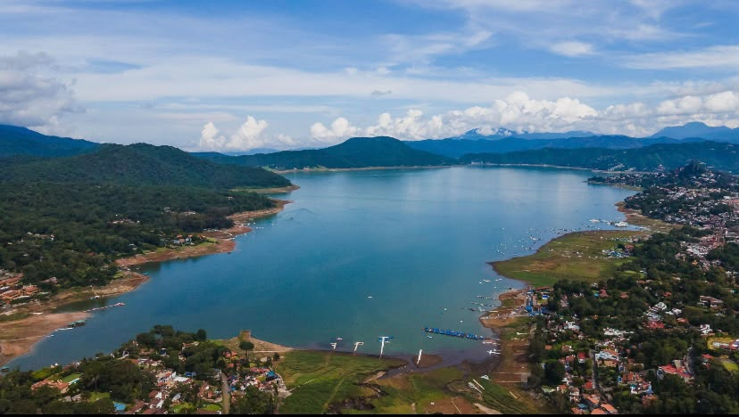

<!DOCTYPE html>
    <html lang="es">

    <head>
        <meta charset="UTF-8">
        <meta name="viewport" content="width=device-width, initial-scale=1.0">

        <title>RIQUEZA NATURAL</title>
        <link rel="icon" href="WEBSITE.jpeg" type="image/jpeg">
        <link href="https://cdn.jsdelivr.net/npm/bootstrap@5.3.3/dist/css/bootstrap.min.css" rel="stylesheet">

        
    </head>

    <body>
        

            <h1 style="color:rgb(22, 114, 31)">"RIQUEZA NATURAL"</h1>
        <u>
"Valle de Bravo: un tesoro natural lleno de vida, paisajes y biodiversidad que denemos proteger"
</u>
        

        

        

        

        

 
           
        

            <h5 class="card-title">
            Cascada Velo de Novia </h5>
            

            "Destaca por su cascada, sus bosques y sus diversidad de plantas y animales."

            
"Se encuentra en Avándaro, Valle de Bravo. Es una cascada rodeada de abundante vegetación y árboles.

            
"Su entorno es importante porque ayuda a conservar la humedad, proteger el suelo y brindar refugio a distintas especies de animales."

            <ul>
            <li>Flora: cuenta con árboles, helechos, musgos y otras plantas que crecen en ambientes húmedos. </li>
            <li>Fauna: el bosque sirve de refugio para aves, insectos y animales pequeños.</li>
            <li>Importancia ambiental: el agua y la vegetación contribuyen al equilibrio del ecosistema y ofrecen habitad para diversas especies.</li>
            <li>Actividades: se puede realizar caminatas por senderos y observar la naturaleza.</li>

                   

        

        

        

         

        

           
        

            <h5 class="card-title">
            Lago de Valle de Bravo</h5>
            

            "Es importante por sus recursos hídricos, sus paisajes y las especies que habitan en sus alrededores."

            
"Es uno de los principales atractivos naaturales de la región. Está rodeado de montañas y vegetación, y forma parte del sistema de presas que establece de agua a otras zonas del Estado de México y Valle de Mexico. También permite actividades reactivas y alberga vida acuática.

            <ul>
                <li>Flora:en sus alrededores hay bosques de pino, encino y otras propias de la región.</li>
                <li>Fauna:en sus alrededores se pueden encontrar aves acuáticas y terrestres, además de organismos que viven en el agua. </li>
                <li>Importancia ambiental: en su recurso hídrico importante y forma parte de un entorno natural que favorece la biodiversidad.</li>
                <li>Actividades:se practican actividades como kayak, navegación en lancha, vela y pezca deportiva.</li>

                    
        

        

        

         

        

           
        

            <h5 class="card-title">
            Monte Alto </h5>
            

            "Monte Alto es una reserva natural ubicada en Valle de Bravo.Cuenta con bosques de pino y encino,senderos y miradores desde donde se puede apreciar el pisaje del lago y las montañas.Es un pecio importante para conservar la vegetación,proteger la fauna y disfrutar de actividades al aire libre.

            
Sus bosques ayudan a conservar el suelo,favorecer la infiltración del agua y brindar refugia a dispersas especies de animales y plantas.

            <ul>
                <li>Flora:predominan árboles como pinos y encinos,andemás de otras plantas silvestres.</li>
                <li>Fauna:sus bosques sirven de refugio y alimento para aves,pequeños mamíferos y otros animales</li>
                <li>Importancia ambiental:los arboles ayudan a conservar el suelo,capturar carbono y favorecer la infiltracíondel agua del subsuelo.</li>
                <li>Actividades:se puede disfrutar de caminatas,observación de la naturaleza y visitas panorámicas.</li>

                    

        

        

        

# WEBISTE-NAATH1
